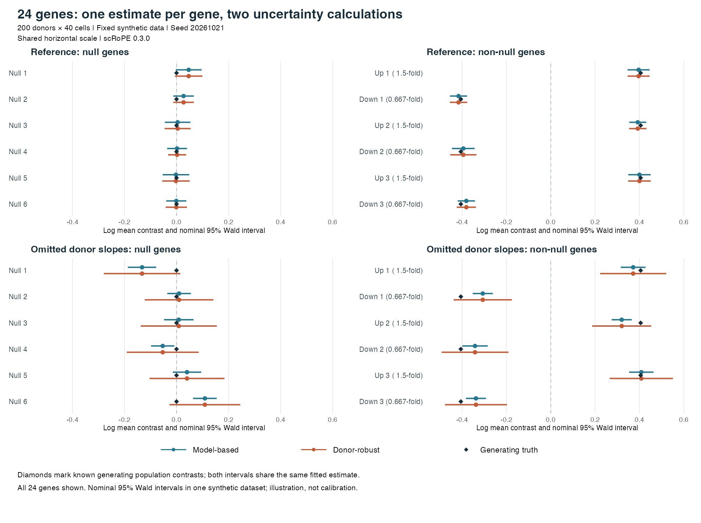

# scRoPE

**Donor-robust inference for multi-donor single-cell RNA-seq**

**scRoPE** (single-cell Robust Parameter Estimation) analyzes differential
expression and regression-based co-expression while retaining cell-level
observations, modeling donor heterogeneity and adjusting for covariates.
Its hierarchical working models account for dependence among cells from the
same donor. Donor-level score variation supplies sandwich (Godambe) uncertainty,
so supported fits can report model-based and donor-robust uncertainty around
the same estimated effect.

- Donor- and cell-level predictors, covariate adjustment and cell-specific offsets.
- Dense or sparse count matrices, with Seurat and SingleCellExperiment conversion.
- Per-gene estimates, inference availability and optional tests and residuals.

## Installation

With R ≥ 4.1 and an R-compatible C++ toolchain, install from GitHub in a fresh
R session:

```r
install.packages("remotes")
remotes::install_github("strug-hub/scRoPE@v0.4.1")
library(scRoPE)
```

This pins the 0.4.1 release. Numbered source releases are listed
on the [releases page](https://github.com/strug-hub/scRoPE/releases).
Record the installed package version and exact source revision for reproducible
analyses. Dependencies are listed in [DESCRIPTION](DESCRIPTION).

## Quick start

The bundled `toy_data` contains 24 synthetic genes from **200 donors × 40 cells**,
with two balanced cell conditions. The default Joint-LN (JLN) engine includes
donor random intercepts and a common condition effect. It omits donor-specific
condition slopes, which are present in the generating model for half the genes.

```r
library(scRoPE)
data(toy_data)

fit <- scrope(
  toy_data$count, toy_data$id,
  pred = toy_data$pred, offset = toy_data$offset,
  ncore = 1, cpc = 0, mincp = 1, verbose = FALSE
)

# Show three rows; fit$summary retains all 24 genes.
show_genes <- c("reference_null_1", "reference_up", "omitted_null_1")
print(fit$summary[match(show_genes, fit$summary$gene), c(
  "gene", "logFC_x", "se_x", "se_robust_x", "p_naive_x", "p_robust_x"
)], row.names = FALSE, digits = 3)
```

Output with scRoPE 0.4.0:

```text
             gene logFC_x   se_x se_robust_x p_naive_x p_robust_x
 reference_null_1  0.0467 0.0254      0.0270  6.55e-02   8.38e-02
     reference_up  0.3961 0.0254      0.0253  6.82e-55   3.31e-55
   omitted_null_1 -0.1326 0.0278      0.0750  1.81e-06   7.72e-02
```

All 24 genes have complete native Wald results in this run:

```r
table(fit$availability$status)
```

```text
available
       24
```

Counts have genes in rows and cells in columns; `id` identifies each cell's
donor, and `pred` is the cell-by-predictor design matrix. Keep cells grouped by
donor and all inputs in the same cell order; `group_cell()` can organize them.
`offset` contains positive exposures, not log exposures. The example's
`cpc = 0, mincp = 1` settings retain all 24 planned genes.

Here, `logFC_x` is the estimated natural-log contrast between conditions.
`se_x` and `p_naive_x` give model-based Wald uncertainty; `se_robust_x` and
`p_robust_x` give donor-robust Wald uncertainty. P-values test a zero coefficient
and have no multiple-testing adjustment.

For `omitted_null_1`, the generating condition effect is zero. Both uncertainty
calculations use the same estimate, −0.133. The donor-robust SE is 0.075 versus
0.028 model-based, giving p-values of 0.077 and 1.8 × 10⁻⁶, respectively.
This illustrates different uncertainty around the same fitted coefficient when
donor slopes are omitted. One simulated dataset does not establish calibration
or show that robust uncertainty corrects coefficient bias.



The bundled reference illustration was generated with scRoPE 0.3.0. Diamonds
mark generating population contrasts; intervals are nominal 95% Wald intervals.
This fixed example illustrates the two uncertainty calculations and does not
establish calibration, power or FDR control. The [complete example](inst/examples/toy24/README.md)
provides the design, provenance, all results and reproduction scripts.

## Main outputs

| Field | Contents |
|:--|:--|
| `fit$summary` | Per-gene coefficients, standard errors and requested test results. |
| `fit$availability` | One status row per analyzed gene. |
| `fit$coefficient_availability` | Per-coefficient estimates, model/robust uncertainty, native/selected availability and route/target labels. |
| `fit$test_status` | Test-specific availability, method labels and failure reasons. |

Compact native flags/reasons and recovery attempted/outcome fields record what
was available before selection without storing another full fit.
Availability distinguishes complete native or recovered results, partial
results, point-only fits and unavailable output. For example, select available
Wald results for the condition coefficient while retaining their provenance:

```r
wald_x <- subset(fit$coefficient_availability,
                 coefficient == "x" & available &
                 statistic_available & reference_available)
wald_x[, c("gene", "beta", "robust_se", "p_value",
           "source", "route", "sampling_target")]
```

Use these tables rather than a common `convergence == 1` filter: convergence
codes have different meanings across engines. Numerical availability does not
establish statistical calibration. Donor-robust inference still requires
independent donors, adequate donor information and suitable estimating-equation
assumptions; it does not correct coefficient bias or a mismatched target.

## Fitting engines and tests

JLN is the default. Select corrected first-order HL with `model = "HL"`, or
exact Poisson–gamma fitting with `model = "PGMM"`.

| Engine | Working model | Native inference |
|:--|:--|:--|
| **Joint-LN (JLN)** | Donor heterogeneity and cell-level overdispersion | Model-based and donor-robust Wald; optional experimental robust Score and Pace-adjusted working-objective ratio. |
| **Corrected first-order HL** | Negative-binomial gamma mixed model | Conventional profile-h model Wald and donor-robust Wald; optional robust Score. |
| **Exact PGMM** | Poisson–gamma mixed model, without a separate cell-overdispersion component | Model-based and donor-robust Wald; optional adjusted Score and scaled adjusted LRT. |

Wald is the default. Request Score with `additional_tests = "score"`, or both
optional tests with `additional_tests = c("score", "lrt")` on JLN or PGMM.
HL supports Score only. JLN's optional tests use an experimental asymptotic
reference for a single non-intercept coefficient tested against zero; its
`"lrt"` request is a working-objective ratio, not an ordinary likelihood-ratio
test. See the [methods guide](inst/guides/methods-and-migration.md#supported-tests-and-output-fields)
for runnable examples, contrast support and test-specific qualifications.

## Recovery and diagnostics

By default, `recovery = "auto"` preserves qualified native fits and assesses
eligible numerical refits, fixed-dispersion working fits or identifiable
limiting routes for the requested engine. Set `recovery = "none"` for
native-only fitting. Detailed fits and histories are opt-in with
`keep_diagnostics = TRUE`; availability tables and compact audit summaries
remain present by default.

Recovery selects a whole fit and preserves original native results in
`fit$recovery$primary` only when `keep_diagnostics = TRUE`. Supported recovery
reports model and donor-robust coefficient Wald inference from the same selected
fit. PGMM/JLN use inverse free information/curvature; corrected HL uses inverse
profile h-likelihood coefficient information at fitted dispersions. Optional
Score/LRT, arbitrary joint tests and random effects remain unavailable. See the
[model-inference guide](inst/doc/selected-model-inference.md) for conventions.
Free-donor-dispersion HL limits remain point-only, without recovered SEs or
p-values.

Inspect the reported source, route and sampling target. Working targets may
differ from scientific targets, and selection-adjusted coverage, general
finite-donor calibration and FDR control are not established. Recovery can
be expensive; compact saved results do not establish a peak-memory bound.
The [recovery and retention guide](inst/doc/automatic-recovery.md) documents
controls, availability statuses, warnings, custom-control behavior and migration.

## Documentation and examples

- `?scrope` — arguments, models and outputs; `?toy_data` — the quick-start data.
- [Complete toy example and reproduction](inst/examples/toy24/README.md).
- [Additional synthetic, Seurat and SingleCellExperiment examples](inst/examples/README.md).
- [Methods, contrasts, specialist interfaces and migration](inst/guides/methods-and-migration.md).
- [JLN recovery](inst/doc/jln-recovery.md) and [HL/PGMM recovery](inst/doc/hl-pgmm-working-recovery.md).
- [Release notes](NEWS.md) and [package validation](tests/validation/README-workable-version-smoke.md).
- [Numerical test policy](tests/NUMERICAL_TESTING.md) and [issue tracker](https://github.com/strug-hub/scRoPE/issues).

## Citation and acknowledgments

**scRoPE manuscript: citation forthcoming.** Use `citation("scRoPE")` for
the installed software citation.

scRoPE builds on the model and computational foundation described in
[*NEBULA is a fast negative binomial mixed model for differential or co-expression analysis of large-scale multi-subject single-cell data* (2021)](https://doi.org/10.1038/s42003-021-02146-6),
*Communications Biology*, **4**, 629.

## License

[MIT](LICENSE.md). Inherited NEBULA copyright and permission notices are
retained. [Source provenance and third-party notices](inst/provenance/README.md#maintained-source-mit-declaration)
document the maintained source and its dependencies.
