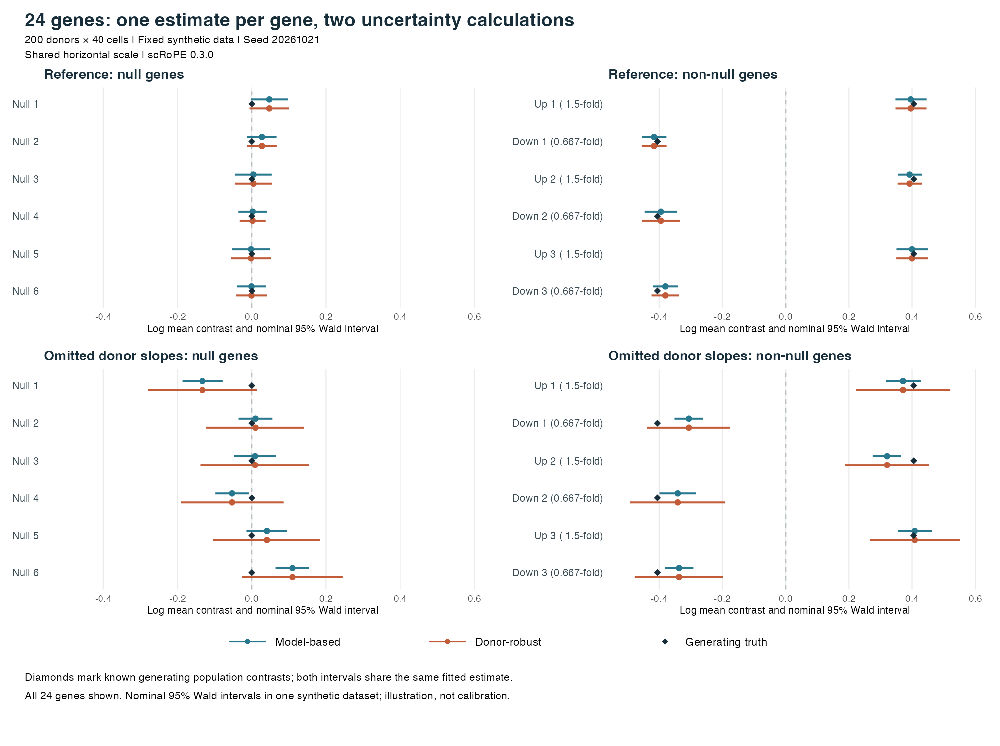

# scRoPE

### Robust uncertainty, at single-cell resolution

**scRoPE** (single-cell Robust Parameter Estimation) analyzes multi-donor
single-cell RNA-seq. Study differential expression
and regression-based co-expression while retaining cell-level observations,
modeling donor heterogeneity and adjusting for covariates.

Its hierarchical working model accounts for dependence among cells from the
same donor. Donor-level score variation then supplies sandwich (Godambe)
uncertainty, reducing reliance on the working model's variance assumptions:
**the same estimated effect, with model-based and donor-robust uncertainty
side by side**.

- **Flexible study designs:** donor- and cell-level predictors, covariate
  adjustment and cell-specific offsets.
- **Inference beyond one test:** model-based and donor-robust Wald results,
  with adjusted Score and likelihood-ratio options for supported engines.
- **Fits into an R workflow:** dense or sparse counts, Seurat and
  SingleCellExperiment conversion, per-gene diagnostics and optional residuals.

## Installation

This README describes the **0.3.0 development candidate**. Until it is published,
install the supplied local archive; the current GitHub version may differ.
With R ≥ 4.1, the dependencies in [DESCRIPTION](DESCRIPTION) and an
R-compatible C++ toolchain, start a fresh R session:

```r
install.packages("scRoPE_0.3.0.tar.gz", repos = NULL, type = "source")
library(scRoPE)
```

From a source checkout, `R CMD build .` creates the archive.

## Quick start: 24 genes in one fit

The bundled `toy_data` contains **200 donors × 40 cells**, balanced between
two cell conditions (`x = -0.5` and `0.5`). It includes null and non-null genes,
with and without donor-specific condition effects. The fitted model retains
a donor random intercept and a common condition effect; the extra donor
slopes are deliberately omitted for half the genes.

```r
library(scRoPE)
data(toy_data)

fit <- scrope(
  toy_data$count, toy_data$id,
  pred = toy_data$pred, offset = toy_data$offset,
  model = "LN", ln_estimator = "joint_ln",
  ln_operational_fallback = "none",
  ncore = 1, cpc = 0, mincp = 1, verbose = FALSE
)

# All 24 genes: one estimate, model-based and donor-robust uncertainty.
fit$summary[, c(
  "gene", "logFC_x", "se_x", "se_robust_x",
  "p_naive_x", "p_robust_x"
)]
fit$availability
```

`logFC_x` is the estimated natural-log contrast between conditions;
`se_robust_x` and `p_robust_x` are its donor-robust standard error and Wald
p-value. The corresponding model-based results are `se_x` and `p_naive_x`.
P-values test a zero coefficient, without multiple-testing adjustment.
Use `availability == "inference"` for certified JLN results.

The reviewed serial fit took **about 11 seconds** on an M3 Max MacBook
(R 4.5.2); timing depends on hardware and software.



In this fixed example, model-based tests flag **3 of 6 omitted-slope null
genes** at `p < 0.05`; donor-robust tests flag **0 of 6**. Both use the same
estimated effects. Diamonds mark known generating population contrasts;
intervals are nominal 95% Wald intervals. This is an illustration, not a
calibration experiment. [Design, interpretation and reproduction](inst/examples/toy24/README.md)
include all genes, the fixed seed, complete results and plotting scripts.

## Choose a fitting engine and test

The **fitting engine** defines the working model. The **inference test**
turns its fit and donor-level information into an uncertainty statement.
JLN is the default; select another engine explicitly with `model`.

| Fitting engine | When to use it | Available inference |
|:--|:--|:--|
| **Joint-LN (JLN)** — `scrope()` | General multi-donor association analysis, with donor heterogeneity and cell-level overdispersion | Model-based and donor-robust **Wald**; opt-in experimental robust **Score** and **Pace-adjusted ratio** |
| **Corrected first-order HL** — `model = "HL"` | An alternative negative-binomial gamma mixed-model fit, including null-constrained Score analysis | Donor-robust **Wald**; optional robust **Score** |
| **Exact PGMM** — `model = "PGMM"` | A simpler Poisson–gamma mixed model with an exact marginal likelihood and optional likelihood-based testing | Model-based and donor-robust **Wald**; optional adjusted **Score** and scaled adjusted **LRT** |

PGMM has no separate cell-level overdispersion component. Request optional
Score with `additional_tests = "score"`; request both optional tests with
`additional_tests = c("score", "lrt")` on JLN or PGMM. HL supports Score only.
Successful fits and test-specific checks determine availability. See the
[methods guide](inst/guides/methods-and-migration.md#supported-tests-and-output-fields)
for calls, contrast support and output fields.

**Explore JLN's optional tests** by adding the request to the quick-start fit:

```r
fit_tests <- scrope(
  toy_data$count, toy_data$id,
  pred = toy_data$pred, offset = toy_data$offset,
  additional_tests = c("score", "lrt"),
  ncore = 1, cpc = 0, mincp = 1, verbose = FALSE
)
fit_tests$summary[, c(
  "gene", "p_score_adj_x", "p_lrt_adj_x",
  "score_success_x", "lrt_success_x"
)]
```

Wald remains the default. JLN's optional p-values use an **experimental
asymptotic reference** for a single non-intercept coefficient tested against
zero. `"lrt"` selects the Pace-adjusted **working-objective ratio**, not an
ordinary likelihood-ratio test. Calibration differs between cell- and
donor-level targets; see [scope, evidence and diagnostics](inst/guides/methods-and-migration.md#jln-experimental-score-and-pace-tests).

For specialist work, the package also contains **internal scalar PGMM relative
profile-likelihood diagnostics**. `scrope_hl()` wraps corrected HL;
explicit `nebula(method = "HL")` retains historical model-based compatibility
fits. These are described in the [specialist and compatibility guide](inst/guides/methods-and-migration.md#specialist-and-compatibility-interfaces).
Legacy LN and its fallback are retired; they are never silently redirected.

## Documentation and examples

- `?scrope` — arguments, models and outputs; `?toy_data` — the quick-start data.
- [Run, regenerate or plot the toy](inst/examples/toy24/README.md).
- [Additional synthetic and Seurat examples](inst/examples/README.md).
- [Methods, contrasts and migration](inst/guides/methods-and-migration.md).
- [Changes](NEWS.md) · [validation](tests/validation/README-workable-version-smoke.md)
  · [report an issue](https://github.com/strug-hub/scRoPE/issues).

## Acknowledgments and citation

**scRoPE manuscript: citation forthcoming.** Use `citation("scRoPE")` for
the installed software citation.

scRoPE builds on the model and computational foundation described in
[*NEBULA is a fast negative binomial mixed model for differential or co-expression analysis of large-scale multi-subject single-cell data* (2021)](https://doi.org/10.1038/s42003-021-02146-6).
*Communications Biology*, **4**, 629.

## License

[MIT](LICENSE.md). Inherited NEBULA copyright and permission notices are
retained. [Source provenance and third-party notices](inst/provenance/README.md#maintained-source-mit-declaration)
document the maintained source and its dependencies.
